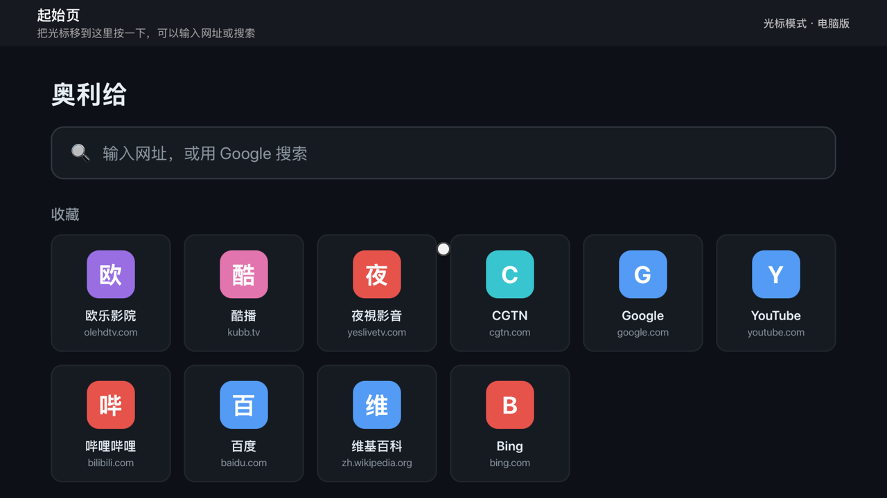
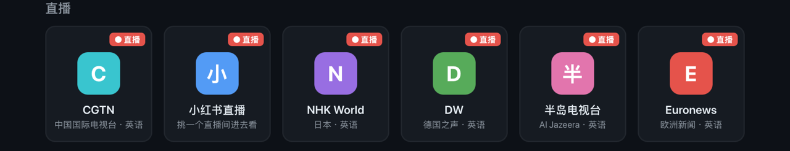

# 奥利给 · Apple TV 网页浏览器

App Store 里没有 Apple TV 能用的浏览器，所以做了这个。用遥控器触控板控制屏幕上的小圆点光标上网，网页里的视频按播放键就用 Apple TV 原生播放器全屏播放。

- 欧乐影院、酷播专门适配：去广告、全屏播放、「下一集」、播完自动下一集
- 「直播」专区：CGTN、小红书直播、NHK World、德国之声、半岛电视台、Euronews
- 收藏、最近看过、历史记录，语音输入网址和搜索

## 下载

### 👉 [点这里下载安装包（aoligei-appletv.zip）](https://github.com/alvvva/aoligei-appletv/releases/latest/download/aoligei-appletv.zip)

大约 4 MB。也可以在右边的 [Releases](https://github.com/alvvva/aoligei-appletv/releases/latest) 里下载。

## 安装（第一次大约 30 分钟）

需要：**一台 Mac**、**一个 Apple ID**（免费的就行）、**Apple TV 和 Mac 在同一个 Wi-Fi**。

1. **装 Xcode**：在 Mac 的 App Store 搜索「Xcode」免费安装，装好后打开一次，点「同意」。
2. **登录 Apple ID**：Xcode 菜单 → Settings → Accounts → 左下角「+」→ Apple ID。
3. **解压**下载的 zip，得到「奥利给-AppleTV安装包」文件夹，整个文件夹都要留着。
4. **双击「安装到AppleTV.command」**。
   第一次 Mac 多半会拦住说「无法打开」：点「完成」关掉，打开 **系统设置 → 隐私与安全性**，往下拉点「**仍要打开**」，输入开机密码。只需要这一次。
5. **跟着窗口提示走**：第一次会让你在电视上打开「设置 → 遥控器与设备 → 遥控器 App 与设备」，在窗口里输入电视上显示的配对码。之后会自动编译、安装、在电视上打开小狗图标「奥利给」。

电视第一次可能会要求：

- 打开开发者模式：电视 **设置 → 隐私与安全性 → 开发者模式**，打开后重启。
- 信任开发者：电视 **设置 → 通用 → 设备管理**，选你的 Apple ID → 信任。

处理完再双击一次「安装到AppleTV.command」。

> **每 7 天要续一次。** 免费 Apple ID 装的 App 7 天后会打不开（苹果的规定）。到时候电视开着，再双击「安装到AppleTV.command」就行，收藏和历史都在。

## 遥控器

| 操作 | 作用 |
| --- | --- |
| 触控板滑动 | 移动光标 |
| 按下触控板 | 点击；点到输入框可以按麦克风键语音输入 |
| 长按触控板 | 菜单：收藏本页、历史、设置 |
| 播放/暂停键 | 网页里有视频时全屏播放 |
| 外圈上/下 | 翻页 |
| 返回键 | 后退 |
| 全屏时 | 按触控板暂停，左右滑拖进度，向下滑调倍速，传输栏有「下一集」 |

## 小贴士

- **欧乐、酷播**：点进一集，按播放键全屏。
- **小红书直播**：不用登录，挑一个直播间点进去（会闪一下换成手机版），按播放键全屏。
- **看不了的**：央视网页直播有加密，请用官方「央视频」App；YouTube 请用官方 YouTube App。放不了的视频会自动退出并说明原因。

完整说明（包括常见问题）见 [使用说明.txt](使用说明.txt)。安装出问题时，把文件夹里的「安装日志.txt」发给分享给你的人。

## 开发

工程说明、测试方法见 [docs/开发说明.md](docs/开发说明.md)。tvOS 没有公开的 WebKit，App 运行时加载系统里的 WebKit，思路来自 [jvanakker/tvOSBrowser](https://github.com/jvanakker/tvOSBrowser)。仅供个人学习使用。
